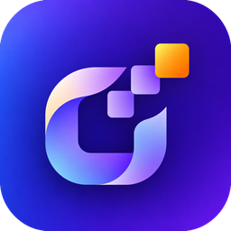

# Logolig

<p align="center"></p>

[](/LICENSE)
[](https://github.com/nabbisen/logolig/actions/workflows/ci.yml)
[](https://docs.rs/logolig)
[](https://docs.rs/logolig-app)
[](https://docs.rs/logolig-i18n)    
[](https://crates.io/crates/logolig)
[](https://deps.rs/crate/logolig)
[](https://crates.io/crates/logolig-app)
[](https://deps.rs/crate/logolig-app)
[](https://crates.io/crates/logolig-i18n)
[](https://deps.rs/crate/logolig-i18n)

A local-first, accessible logo asset generator GUI.

PNG / SVG / WebP / JPEG goes in. A polished favicon bundle and, when enabled,
small Microsoft app logo assets come out — all on your machine, with no upload
anywhere.

Built on [iced](https://iced.rs/) and [snora](https://github.com/nabbisen/snora).


## Why

Existing online favicon generators have problems:

- Image quality degrades on resize (jaggies, fuzziness, lost detail)
- Images are uploaded to a third-party server
- Output is bloated with sizes you don't need
- Generated HTML often skimps on accessibility
- The UI demands too many decisions up front

Logolig addresses all of these as **design requirements**, not
afterthoughts. See `docs/src/architecture.md` for the rationale.

## Installation

Requires Rust 1.90 or newer.

### From source

```sh
git clone https://github.com/nabbisen/logolig
cd logolig
cargo install --path crates/app
logolig
```

`cargo install` places a `logolig` binary in `~/.cargo/bin/`. Make
sure that directory is on your `$PATH`.

### From crates.io

```sh
cargo install logolig-app
logolig
```

## Running without installing

```sh
cargo run -p logolig-app --release
```

## Usage

The app uses a three-item side navigation: **Home**, **Customize**, and
**Settings**. On narrow windows the same navigation moves to the bottom.

1. On **Home**, click anywhere inside the bordered drop-zone card to open the file picker and
   choose a PNG, SVG, WebP, or JPEG. Where your system delivers file drops, you can also drop the
   file onto the window (on some systems, for example some Wayland setups, drops do not arrive).
   - JPEG inputs work, but the format cannot store transparency, so
     Logolig shows an educational toast suggesting a PNG with the
     background cut out for favicons that adapt to light and dark tabs.
   - Logolig goes by what a file contains, not by its name: a JPEG named
     `logo.png` is used as a JPEG, and a notice says so. Files up to
     64 MiB (SVG: 8 MiB), 50 megapixels and 16 384 pixels on a side are
     read; a larger one is not loaded, and a message says what to do.
2. Logolig converts immediately after ingest and then shows the **Result**
   screen. Each generated asset appears as a card with a thumbnail or
   document placeholder, dimensions where applicable, file size, and an
   individual download button.
3. Use **Preview** on the Result screen when you want to inspect the icon
   in browser-tab, phone-home, or checkerboard contexts before saving.
4. Save one asset with its card download button, or save the whole result
   set with **Download all (ZIP)**. Conversion itself is in-memory; files
   are written only when you choose a download target.
5. Use **← Back** to return to the drop zone. The last result remains in
   memory for the session and can be reopened from the **Last conversion**
   card without re-converting.

Use **Customize** for output settings: PNG sizes, SVG conversion mode,
keep-transparency behavior, and the collapsible **Advanced settings**
section for Apple touch icon, HTML snippet, web manifest, monochrome output,
resize algorithm, raster vectorization, and Microsoft app logos.

Use **Settings** for language and theme. Supported languages are English,
Japanese, and system default; themes are light, dark, and system. **System** follows
your operating system's light or dark setting while Logolig runs (on Linux through the
desktop portal; where nothing reports a theme it uses light, and Settings says so).
Windows and macOS have not been tried by a person.

To make everything larger, choose **Interface size** in **Settings**: **Normal**,
**Large** (125 %) or **Extra large** (150 %). Text, icons and spacing grow together, the
choice is saved, and the window keeps a minimum size so that nothing is cut off. Your
operating system's display scaling still works too: checked on a native Wayland session (an
output scale of 1.2 made the window 1.2 times larger); under X11 (including XWayland) the
application was **not** scaled by the system in that check, so there the Interface size
setting is the way to enlarge it. Windows and macOS were not checked.

The generated `favicon-snippet.html` is paste-ready for your `<head>`.

**Keyboard.** Everything can be done without the mouse. Tab and Shift+Tab move
through the controls (the side navigation first, then the page; a ring shows the
focused control and the page scrolls to keep it in view), Enter and Space press a
button or toggle a checkbox, and the arrow keys choose within a group of choices.
Shortcuts: Ctrl+O choose a file, Ctrl+S download all (ZIP), Esc close the message or
go back, Ctrl+1 / 2 / 3 Home, Customize, Settings, F1 the list (Cmd replaces Ctrl
on macOS). Screen readers are not supported yet.

State is never conveyed by color alone (ABDD §12): the active page in the
navigation has a filled item, a bold label and a thin accent bar toward the
content; the chosen option of a choice (language, theme, View as, Surface, SVG
conversion, resize algorithm) is a filled dot in a ring; a checked option is a
ticked box. These marks are drawn, not typed, so they do not depend on the
fonts installed.

## What gets written

By default, seven artifacts:

- `favicon.svg` (vector — SVG source is preserved as-is; raster sources are
  vectorized via [vtracer](https://github.com/visioncortex/vtracer))
- `favicon.ico` (with 16, 32, 48 frames, each rendered independently)
- `apple-touch-icon.png` (180×180)
- `favicon-32.png` / `favicon-192.png` / `favicon-512.png`
- `favicon-snippet.html` (the `<link>` block for your `<head>`)
- Optional Microsoft app logos: `StoreLogo.png`, `Square44x44Logo.png`,
  `Square150x150Logo.png`, and `Wide310x150Logo.png`

The set is intentionally minimal. The SVG output is referenced first in the
generated HTML so modern browsers prefer it on high-DPI displays; older
browsers fall back to the ICO and PNGs.

If your input is a photograph or otherwise unsuitable for vectorization,
turn off **Turn a PNG, WebP or JPEG into SVG** in Customize → Advanced settings to skip
`favicon.svg` for that run.

Optionally, enabling **Output `manifest.webmanifest`** (since v1.8.0) adds a
PWA `manifest.webmanifest` to the output, alongside a matching
`<link rel="manifest">` line in the HTML snippet. The manifest's `icons`
array mirrors the PNG sizes you've configured.

See `docs/src/export-spec.md` for the rationale on what is **not** emitted (no
`browserconfig.xml`, no `msapplication-*`).

## Layout

- `crates/core` — pure domain types and image processing.
  No iced / snora / GUI dependency. The dependency graph enforces
  this: importing iced from inside core is a compile-time error.
- `crates/i18n` — bundled dictionaries and locale resolution.
- `crates/app` — the iced + snora GUI binary, compiled to `logolig`.

Documentation lives under `docs/src/`:

- `architecture.md` — module layout, state model, message flow, release history
- `functional-spec.md` — what the application does, screen by screen
- `ui-a11y.md` — Accessible-by-Default-and-by-Design (ABDD) commitments, keyboard support
- `export-spec.md` — output artifacts and HTML snippet shape

Release notes are in `docs/release-notes/`. The plan and order of work is in
[`ROADMAP.md`](/ROADMAP.md).

### Maintainers

Design decisions are recorded as RFCs under [`rfcs/`](/rfcs/); how an RFC moves from
`proposed/` through `accepted/` to `done/` (or `archive/`) is the lifecycle policy in
[`rfcs/README.md`](/rfcs/README.md).

## Settings persistence

Your output settings, theme, and locale override are saved automatically as
you change them. Storage location:

- Linux: `$XDG_CONFIG_HOME/logolig/settings.json` (or `~/.config/logolig/settings.json`)
- macOS: `~/Library/Application Support/logolig/settings.json`
- Windows: `%APPDATA%/logolig/settings.json`

The file is plain JSON; you can hand-edit it or delete it to reset to
defaults. Logolig reads it on startup and falls back to defaults if it
doesn't exist or can't be parsed (older logolig versions can read newer
files because of `serde(default)` forward compatibility).

If saving fails (read-only config dir, etc.), a warning toast is shown
and the app keeps running — your changes stay in memory for the session.

## Transparency

Logolig audits each loaded image's alpha channel and warns about two
common favicon mistakes:

- **Fully opaque image** — every pixel has alpha=255. The favicon will
  show as a white square on dark browser tabs. Usually you want to
  remove the background before export.
- **Empty image** — every pixel has alpha=0. Likely the wrong file was
  loaded.

The warning shows once per loaded image as a Toast and lets you
continue regardless. Halo detection and pre-multiplied-alpha analysis
are intentionally not included — their thresholds risk false positives
on legitimate anti-aliasing.

Choose **Checker** under **View as** in the preview panel to swap the
browser-tab / smartphone framing for a checker-pattern view: light
and dark grey 12px tiles with the icon overlaid at native size, so
transparent regions are visually unambiguous.

## Web manifest (PWA)

When **Output `manifest.webmanifest`** is enabled in Customize → Advanced
settings,
Logolig writes a [W3C Web App Manifest](https://www.w3.org/TR/appmanifest/)
alongside the favicons. The four user-editable fields are:

- **Name** — the full app name shown on the home screen
- **Short name** — fallback for narrow contexts (recommended ≤12 chars)
- **Theme color** — the browser UI accent (`#RRGGBB`)
- **Background color** — the splash-screen background (`#RRGGBB`)

The manifest's `icons` array is generated from the PNG sizes you have
configured, so it stays in sync with what's actually written to disk.
`start_url` and `display` are fixed at `"/"` and `"standalone"` for v1.8 —
favicon users rarely need to change these, and exposing every W3C field
would defeat the "fewer settings" design (§5). v1.8.x can lift this
limitation if a real need surfaces.

Colors are written as `#RRGGBB`; you may also type the short form `#RGB`
(`#1ab` means `#11AABB`), in any letter case. A name must not be empty. What
you type is checked as you type: **a value that is not valid is never used or
saved**: the last valid value stays, and a line under the field, with a warning
icon, says what is accepted ("Use a color like #1A2B3C or #1AB", "Enter a
name"). It appears only after you have typed in the field or pressed Enter in
it, not on the untouched defaults. Press Enter to see the value in its final
form (`#1ab` becomes `#11AABB`). If a hand-edited settings file holds a value
that is not valid, Logolig starts anyway, uses the default for that value and
tells you once; the export itself also refuses an invalid manifest.

## Monochrome output

When **Output `mono/` grayscale set** is enabled in Customize → Advanced
settings,
Logolig adds a grayscale version of each PNG and the ICO under a `mono/`
subdirectory:

```
your-output-dir/
├── favicon.svg
├── favicon.ico
├── apple-touch-icon.png
├── favicon-32.png
├── favicon-192.png
├── favicon-512.png
├── favicon-snippet.html
└── mono/
    ├── favicon.ico
    ├── favicon-32.png
    ├── favicon-192.png
    └── favicon-512.png
```

The grayscale conversion uses the [BT.709 luma formula](https://en.wikipedia.org/wiki/Rec._709)
(`Y = 0.2126 R + 0.7152 G + 0.0722 B`), the modern sRGB-aligned standard.
Alpha is preserved per pixel — transparent regions stay transparent.

Typical use cases:

- **Single-color print** (business cards, faxes, embroidery) where the
  color version would muddy
- **Theme-aware mask icons** referenced from CSS via `mask-image` so the
  user agent can recolor the icon to match light/dark mode
- **Stencil and design-asset re-use** where you want a flat tone version
  of the logo

### Wiring monochrome into your `<head>` (optional)

Logolig does **not** auto-inject `<link>` lines for monochrome icons —
how you use them is too project-specific to template. The most common
pattern uses CSS `prefers-color-scheme` to swap which icon the browser
should pick. Here is the diff you can paste into the snippet Logolig
generated:

```diff
 <link rel="icon" type="image/svg+xml" href="/favicon.svg">
 <link rel="icon" href="/favicon.ico" sizes="any">
 <link rel="icon" type="image/png" sizes="32x32" href="/favicon-32.png">
 <link rel="icon" type="image/png" sizes="192x192" href="/favicon-192.png">
 <link rel="icon" type="image/png" sizes="512x512" href="/favicon-512.png">
 <link rel="apple-touch-icon" sizes="180x180" href="/apple-touch-icon.png">
+
+<!-- Dark-mode icon overrides (monochrome set) -->
+<link rel="icon" type="image/png" sizes="32x32"
+      href="/mono/favicon-32.png" media="(prefers-color-scheme: dark)">
+<link rel="icon" type="image/png" sizes="192x192"
+      href="/mono/favicon-192.png" media="(prefers-color-scheme: dark)">
+<link rel="icon" type="image/png" sizes="512x512"
+      href="/mono/favicon-512.png" media="(prefers-color-scheme: dark)">
```

Alternative: use the mono PNG as a CSS mask-image so the icon picks up
the user's accent color automatically:

```css
.app-icon {
  background: currentColor;
  mask-image: url("/mono/favicon-192.png");
  mask-size: cover;
}
```

ICO is shipped as `mono/favicon.ico` for completeness — its primary use
case is legacy `favicon.ico` URLs at the site root, which can't easily
be theme-swapped, but it's there if you need it.

SVG monochrome is not yet supported. The naive "replace `fill`
attributes" approach breaks on gradients, external CSS, and inline
styles, so a future release may go raster → grayscale →
re-vectorize via vtracer instead.

## Language

Logolig follows your system language by default. Open **Settings** to choose:

- **System default** — use the OS locale (`LANG` on Linux,
  `NSLocale` on macOS, user UI language on Windows)
- **English** — explicit override
- **日本語** (`あ`) — Japanese (since v1.6.0)

The selection persists across sessions.
Locale detection accepts the common forms — `en`, `en-US`, `en_US`, `ja`,
`ja-JP`, `ja_JP`, even `ja_JP.UTF-8` from POSIX `LANG` — so most users
need no override.

If your OS locale isn't supported yet, Logolig falls back to English
without warning. New languages are added by dropping a TOML file under
`crates/i18n/locales/` and adding a `Locale` enum variant —
the enum's exhaustiveness check ensures every UI string and error
message has a translation, or the build fails.

## Tests

```sh
cargo fmt --check
cargo clippy --workspace --all-targets --all-features -- -D warnings
cargo test --workspace --all-features
cargo audit
```

The same gates run in CI on every pull request and every push to `main`.

The core tests cover ingest, decode, SVG rasterization, vectorization,
resize, preview cache, ICO writing, HTML snippet generation, in-memory and
disk export, settings round-trip, transparency classification, web manifest
JSON generation, Microsoft app logo output, and monochrome conversion. The
i18n tests cover dictionary loading, placeholder substitution, error
translation, and BCP-47 locale resolution. The app crate has focused
`update()` smoke tests for navigation, settings changes, history, and
drag/drop state.

The tests run at three levels, each used for what it can prove cheaply. **Logic and state** (above)
are plain `update()` tests with no interface. **The headless interface** lays the whole `view` out
on the CPU, without a window, a GPU or a display (`iced_test`), and checks properties of the layout
in every combination of window size, screen, language and theme: nothing lies beyond the right
edge, no text is squeezed to nothing, every interactive area is at least 24 x 24 px, and the
main controls are fully visible. These tests are in `crates/app/src/ui_layout_tests/`, run with the
rest of `cargo test` and in CI (about half a minute); the probe names the CPU renderer explicitly.
They also check the keyboard model: Tab visits every control in the order of the screen, the focused
control is always fully visible, and no control can be reached by the pointer but not by Tab.
**The real window** is for what needs eyes or a real desktop portal, a few captures at a time.

A headless property that fails today is not committed red: its known failures are a named list in
the test (`KNOWN`), and a job that fixes one deletes its entry; a test also fails if an entry no
longer matches anything, so the lists end empty.

The headless layout does not use the machine's fonts at all: it uses Fira Sans, the icon fonts
and a small Japanese test subset kept with its checksums in `crates/app/test-assets/fonts/` (not
shipped), so it gives the same answer on every machine. The real window uses the system's fonts,
so the headless sizes agree with it to within about a pixel (measured: 0.6 px on two buttons at
1042 x 1144), not exactly: the headless level finds layout defects, it does not judge how text
reads.

## Versioning

This repository contains **v1**: the iced-based native desktop
build. v1.0.0 was the feature-complete release against the original
specification; subsequent v1.x releases (WebP input, SVG output,
advanced settings UX, persistence) extended it without breaking
compatibility.

A separate **v2** branch is planned that retargets the same
`logolig` to a leptos-based WebAssembly build for
privacy-preserving in-browser use. The split is possible because
`logolig` carries no GUI-framework dependency. The v1.4.0
`SettingsStore` trait is the seam: v2 will provide a `BrowserStore`
implementation backed by `localStorage` while reusing the same
`PersistedSettings` schema.

## License

Licensed under the Apache License, Version 2.0. See [`LICENSE`](/LICENSE).

Copyright 2026 nabbisen
